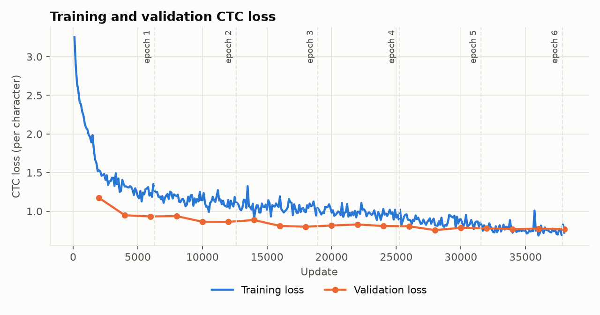
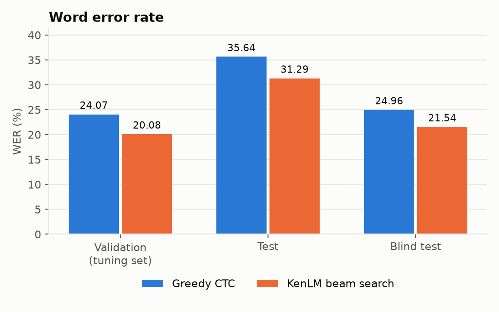
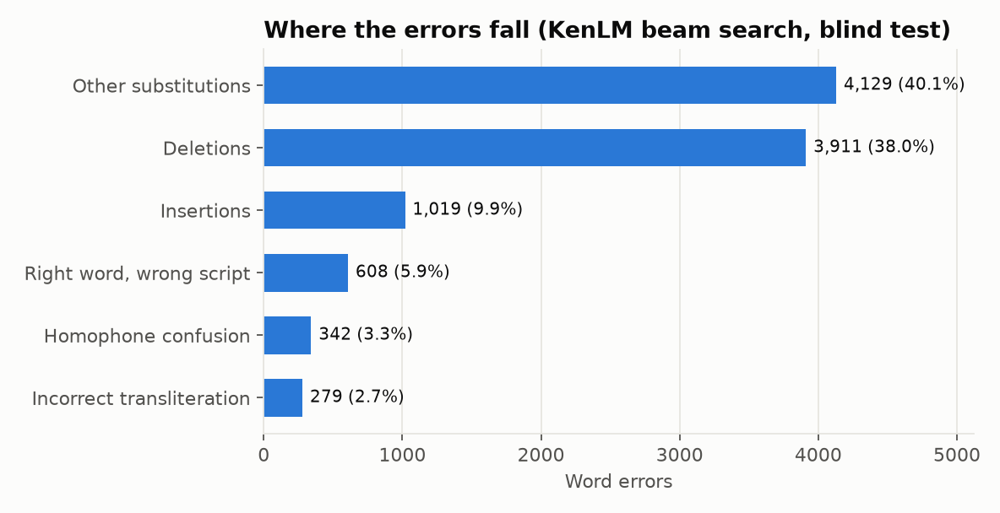

# Stage 1B Report: Baseline Training, KenLM Decoding and Evaluation

This is iteration 1 of the project: wav2vec 2.0 with a CTC head, greedy decoding and KenLM beam search, trained on MUCS 2021 Subtask-2 (Hindi–English). Every number below was measured on this repository's code. Nothing is estimated, and published values appear only in the clearly marked reference rows.

## Results at a glance

**Blind test, KenLM beam search: WER 21.54, T-WER 20.22.** The organisers' own `compute_wer.py` gives the same two numbers.

| System | Blind WER | Blind T-WER | Source |
|---|---|---|---|
| **This baseline, KenLM beam search** | **21.54** | **20.22** | Measured here |
| This baseline, greedy | 24.96 | 23.99 | Measured here |
| *Official MUCS baseline* | *25.53* | *23.80* | *Published (Diwan et al. 2021)* |
| *Chadha et al. 2022, Approach C2* | *21.77* | *20.75* | *Published* |
| *Best leaderboard entry* | *16.43* | *15.51* | *Published (JHU-CLSP/GoVivace)* |

The Stage 1B success criterion was to beat the official baseline and land in the 21–24 WER band. Both hold: 21.54 is 3.99 below the official baseline. The result is close to Chadha et al.'s, but that is a reference point, not a reproduction claim. Our encoder checkpoint may not be theirs (see Deviations), and every number here comes from a single training run, so differences under about 1 WER should not be read as real.

---

## A. Implementation

Everything below was executed for the reported numbers.

| Component | Where | What it does |
|---|---|---|
| Data pipeline | `src/data/` | Downloads MUCS 2021 Subtask-2 with CRC checks, builds JSONL manifests per split, holds out a 4-hour val set of whole training recordings, and loads 16 kHz segments |
| Tokenizer | `src/models/tokenizer.py` | 120 characters from training transcripts only: 63 Devanagari, 26 Latin, 10 digits, 16 symbols, 5 specials |
| Model | `src/models/ctc_model.py` | `Wav2Vec2ForCTC` from him-4200. The 62 characters the checkpoint already knew keep their head rows, and 58 new rows start untrained. The checkpoint's real CTC blank is `<s>`, not its pad token, and is mapped to our blank |
| Training | `src/training/train.py` | FP16 with a gradient scaler, gradient checkpointing, accumulation, tri-stage LR, three parameter groups, exact resume, best checkpoint by val WER |
| Greedy decoding | `src/beam_search.py` | Arg-max per frame, collapse repeats, drop blanks |
| Language model | `src/language_model.py` | 5-gram interpolated Kneser-Ney from `train.jsonl` only, then the KenLM binary format |
| Beam search | `src/beam_search.py` | pyctcdecode 0.5.0 with KenLM, run in parallel over cached log-probabilities |
| Tuning | `src/tune_lm.py` | LM weight, insertion score, OOV penalty and beam width, on val only |
| Logit cache | `src/logit_cache.py` | One forward pass per utterance at batch size 1, stored as float16 log-probabilities, so both decoders see identical acoustics |
| Evaluation | `src/evaluate.py` | Decodes a split, writes hypotheses and per-utterance JSONL, and scores it. On blind it re-runs the organisers' `compute_wer.py` and stops if the two disagree by more than 0.01 |
| Metrics | `src/metrics/` | WER, CER, official T-WER, approximate T-WER for test |
| Error analysis | `src/analysis/error_analysis.py`, `src/analysis/boundary_errors.py` | Word alignments sorted into the ten categories, and errors at segment edges |
| Plots | `src/analysis/plots.py` | Every figure in `results/figures/`, drawn from the logs and result files |
| Single-file inference | `src/inference.py`, `src/check_inference.py` | Transcribes one audio file or segment. The check confirms it matches the evaluated pipeline |

**Unit tests:** 64 in `tests/`, all passing. They cover:
- the metrics, against jiwer and hand-worked cases
- the official scoring rules
- the LM builder's guard against non-training data
- the decoder's label mapping
- the error categories and edge-error counting
- checkpoint averaging and the script-normalisation rules (both added for later iterations)

### Decoding pipeline check

`src.check_inference` transcribed 25 val utterances one at a time from raw audio, the way a user would. It compared them with the evaluated results: 24 matched exactly, and 1 differed by one character at a float16 tie. On frame 0 of that utterance, य and अ are 0.0006 apart in float32 and identical after the cache rounds them to float16. The largest log-probability difference across the 25 utterances was 0.0078, within float16 rounding. The check fails on any difference larger than rounding, or on any text difference not explained by such a tie. Results are in `results/inference_check.json`, with audio paths, references and predictions.

---

## B. Training

### Data

| Split | Utterances | Hours | Recordings | Latin words | Role |
|---|---|---|---|---|---|
| train | 50,509 | 85.55 | 499 | 25.11 % | Training and the LM |
| val | 2,316 | 4.01 | 22 | 23.76 % | Checkpoint selection and all tuning |
| test | 3,136 | 5.18 | 30 | 24.26 % | Reported only |
| blind | 4,034 | 6.24 | 35 | 32.27 % | Reported only; the headline split |

- **Val** is 22 whole training recordings, held out with seed 1234, so no recording is in both train and val.
- **Dropped utterances:** 7, because their transcripts have more characters than the model has output frames. Training saw 50,502.
- **No truncation:** no audio was cut, and the longest utterance (57 s) trains whole.
- **Blind labels:** used only for scoring. They never touched training, the LM or tuning.

### Configuration

| Setting | Value | Source |
|---|---|---|
| Encoder | `Harveenchadha/vakyansh-wav2vec2-hindi-him-4200`, 94.42 M parameters, fully fine-tuned | Stage 1A decision |
| Updates | 38,000, about 6 epochs | Ours |
| Batch | 1 utterance per step with 8 steps of accumulation, so 8 utterances per update | RTX 3050 prompt |
| Learning rates | CNN 1e-5; transformer and CTC head 1e-4 | CNN rate as requested; the other two measured (below) |
| Schedule | Tri-stage: 10 % linear warm-up, 40 % hold, 50 % cosine decay to zero | Ours |
| Optimiser | AdamW, betas 0.9/0.98, weight decay 0.01, gradient clipping at 1.0 | Weight decay and clipping as requested |
| Precision | FP16 autocast; gradient scaler starting at 256 | As requested |
| Memory | Gradient checkpointing; GPU memory capped at 75 % | Cap measured: uncapped, Windows spilled 7.25 GB into system RAM |
| Masking | Time masks, probability 0.065, length 10 | Ours |
| Data loading | Main process, pinned memory | Measured: 2 workers were slower on Windows (1.30 against 1.11 s/update) |
| Seed | 42 | Single seed |
| Validation | Every 2,000 updates and at each epoch end; best checkpoint by val WER (greedy, cleaned text) | Ours |

Config: `configs/train_baseline.yaml` (hash `a9890d1f3180`), trained at commit `41ed0f0` from a clean tree.

### Why the transformer runs at 1e-4

The requested 1e-5 for all parameters trained but never produced English. The table below measures greedy output on the same 150 val utterances, whose references are 23.2 % Latin words.

| Run | Update | Val loss | Latin words in output | Mean Latin probability | Deletions |
|---|---|---|---|---|---|
| Untouched checkpoint | 0 | – | 0 % | – | 175 |
| Everything at 1e-5 | 4,000 | 1.58 | 0 % | 3.3 % | 298 |
| Encoder 1e-5, head 1e-4 | 2,000 | 1.60 | 0 % | 3.3 % | 298 |
| **CNN 1e-5, transformer and head 1e-4** | 2,000 | **1.17** | **29.6 %** | **18.3 %** | **111** |

A faster head alone did not raise the probability of Latin letters, because the head cannot tell which language is being spoken; the transformer has to learn that. The CNN kept the requested 1e-5, since one smoke-test step at 1e-4 took a batch from 63 to 93 % WER. Details are in `results/learning_rate_investigation.json`.

### Hardware and duration

| Item | Value |
|---|---|
| GPU | NVIDIA GeForce RTX 3050 6 GB Laptop, driver 592.82 |
| CPU and RAM | AMD Ryzen 7 7840HS, 15.3 GB |
| Duration | 31,905 s (8 h 52 min), 0.84 s per update including validation |
| GPU memory | 2.90 GB peak allocated, 4.61 GB peak reserved |
| GPU load | 85 % mean utilisation, 59 W, 1,850 MHz mean clock |
| Temperature | 67.4 °C mean, 69 °C maximum |

The per-minute GPU log is `results/gpu_log.csv`.

### Learning curve



| Update | Epoch | Train loss | Val loss | Val WER | Blank frames |
|---|---|---|---|---|---|
| 2,000 | 0 | 1.529 | 1.172 | 43.89 | 79.3 % |
| 6,000 | 0 | 1.237 | 0.932 | 32.88 | 77.6 % |
| 12,000 | 1 | 1.145 | 0.862 | 30.77 | 78.5 % |
| 16,000 | 2 | 1.193 | 0.810 | 35.16 | 80.4 % |
| 20,000 | 3 | 0.982 | 0.815 | 28.85 | 76.1 % |
| 26,000 | 4 | 0.888 | 0.805 | 26.91 | 76.9 % |
| 30,000 | 4 | 0.896 | 0.785 | 25.41 | 77.0 % |
| 34,000 | 5 | 0.721 | 0.769 | 23.96 | 77.0 % |
| **37,872** | 6 | 0.763 | 0.768 | **23.77** | 77.1 % |
| 38,000 | 6 | 0.721 | 0.768 | 23.78 | 77.1 % |

Val WER here is the training-time check: greedy decoding on cleaned text. **The best checkpoint is update 37,872**, at `data/checkpoints/baseline_rtx3050/best/`. Every logged row is in `results/train_log.csv` and `results/epoch_log.csv`, with curves in `results/figures/val_wer.png` and `results/figures/learning_rate.png`.

### Health checks

- **Overfitting: none yet.** Val loss reached its lowest value at the last update, and val WER improved at every check from 28,000 onward. Train loss is measured with dropout and masking on, so it sat above val loss for most of the run. It fell below val loss from update 34,000 (0.72 against 0.77), so the gap is closing, and longer training should watch for it.
- **Loss: stable.** Mean train loss fell in every phase: 2.15, 1.33, 1.16, 1.06, 0.97, 0.86, 0.76. The val WER bump at 16,000 (35.2) came during the high-LR hold and was gone by 18,000.
- **Gradients: stable.** Pre-clip norms had a median of 8.0 and a 90th percentile of 23.6, and the largest logged was 109. Clipping at 1.0 held at every step. The scaler cut its scale 17 times in 38,000 updates, and no batch was skipped as non-finite.
- **Blank frames: normal.** 77.1 % at the end, against 79.1 % for the untouched checkpoint. The failed learning-rate runs that deleted words sat at 83–84 %.
- **CTC alignment: some bad segments.** On 150 val utterances, the untouched checkpoint lost over 40 % of the characters in 13, a sign that some MUCS segment boundaries cut speech. Section D measures the same effect on the test sets.

---

## C. Evaluation

### Metrics

| Metric | Definition | Status |
|---|---|---|
| WER | (S + D + I) / N, summed over utterances, under the organisers' rules: both sides lower-cased, spoken punctuation in the hypothesis mapped to symbols (`dot` to `.`), empty references skipped | Official on blind, confirmed by re-running `compute_wer.py` |
| CER | The same, over Unicode code points with spaces counted, on the same normalised strings | Ours. There is no official CER |
| T-WER | WER after the hypothesis is also mapped through `hin2engwords.txt`, so an English word written in Devanagari counts as correct | Official on blind. On test it is an **approximation**: test references are not annotated the same way, so both sides are mapped, with a map built for blind's vocabulary |

Assumptions:
- **References** are the raw transcripts, not our cleaned training text.
- **Empty references:** blind has 8. They are skipped, as the official script does.
- **Empty hypotheses** are kept and count as deletions.
- **Val gets no T-WER,** because the map was built from blind references and val drives tuning.

The metric code is unit-tested against jiwer and hand-worked cases. Our WER and T-WER agree with the official script to 0.01 on every blind run. **This is still not the official MUCS evaluation service:** the organisers scored submissions themselves, and only their script is reproduced here.

### Language model

| Item | Value |
|---|---|
| Text | `train.jsonl` only: 50,509 sentences, 604,999 words. Val is excluded because it is used for tuning; test and blind are never read |
| Normalisation | The training transcript cleaner. Both scripts kept as written, no transliteration |
| Tokenisation | Words split on whitespace |
| Vocabulary | 17,005 words |
| Order and smoothing | 5-gram, interpolated Kneser-Ney, discounts 0.61, 0.74, 0.85, 0.90, 0.82 by order |
| Pruning | None. Every observed n-gram is kept: 17,008 / 157,702 / 304,587 / 368,621 / 378,722 by order |
| Files | ARPA 68.5 MB, KenLM binary 27.45 MB, in `data/language_model/` |
| Builder | Built in, because `lmplz` needs Boost, which this machine lacks. `build_binary` is KenLM's own |

Report: `results/lm_report.json`.

| Split | Word tokens not in the LM vocabulary | Word types | Latin tokens |
|---|---|---|---|
| val | 2.69 % | 13.8 % | 5.55 % |
| test | 2.95 % | 13.6 % | 4.72 % |
| blind | 3.65 % | 19.9 % | 8.47 % |

### Decoder tuning, on val only

`src.tune_lm` decoded all 2,316 val utterances for each setting in five stages:
1. A 7 × 5 grid of LM weight and word insertion score, at beam width 50.
2. 14 finer points around the winner.
3. Three OOV penalties.
4. Beam widths from 50 to 3,000, where a wider beam had to gain at least 0.05 WER to be chosen.
5. A separate check of gentler OOV penalties, because −5 sat at the edge of the grid.

All 58 configurations are in `results/lm_tuning.csv`.

| Stage | Best | Val WER (cleaned) |
|---|---|---|
| LM weight × insertion grid | α 0.35, β 1.0 | 19.94 |
| OOV penalty: −5, −10, −20 | −5 | 19.78 |
| Gentler OOV penalties: −4, −3, −2, −1, 0 | none better (19.83, 19.89, 20.12, 20.52, 21.51) | – |
| Beam width: 50, 100, 200, 500, 1,000, 3,000 | 500 | 19.70 |

Widths 1,000 and 3,000, the latter the paper's setting, gave 19.71 and 19.73, so the wider beam did not help this model. **The frozen settings are α 0.35, β 1.0, OOV penalty −5, width 500**, committed in `configs/decode.yaml` at `c416894`, before any test or blind decoding.

### Results

Val, test and blind are kept separate. **Only blind is the headline.** Val was used for every choice, and test is reported for completeness.

**Validation (the tuning set, 2,316 utterances, 28,471 words)**

| Decoder | WER | CER | T-WER |
|---|---|---|---|
| Greedy | 24.07 | 15.82 | – |
| KenLM beam | 20.08 | 15.24 | – |

**Test (3,136 utterances, 37,611 words)**

| Decoder | WER | CER | T-WER (approximate) |
|---|---|---|---|
| Greedy | 35.64 | 26.78 | 33.02 |
| KenLM beam | 31.29 | 25.81 | 28.25 |

**Blind test (4,026 scored utterances, 47,764 words)**

| Decoder | WER | CER | T-WER |
|---|---|---|---|
| Greedy | 24.96 | 14.04 | 23.99 |
| **KenLM beam** | **21.54** | **13.65** | **20.22** |



CER and T-WER charts are in `results/figures/`. Per-utterance outputs, with audio path, segment times, reference and hypothesis, are in `results/evaluations/<split>_<decoder>.jsonl`, and `results/figures/sample_predictions.md` shows evenly spaced blind examples.

**Why test is so much worse than blind.** The test segments line up worse with their transcripts. Errors at the first and last word make up 3.95 % of test words, against 3.35 % on blind and 2.22 % on val (Section D). The MUCS paper saw the same gap in its unaligned condition: GMM-HMM test 44.30 against 31.56 after realignment. Do not compare test and blind numbers.

### Greedy against KenLM

On blind, the LM cut WER by 3.42 and T-WER by 3.77, but CER by only 0.39, so most of the gain is whole words snapped to the right spelling.

| Blind, word errors | Greedy | KenLM | Change |
|---|---|---|---|
| Other substitutions | 5,984 | 4,129 | −1,855 |
| Deletions | 3,896 | 3,911 | +15 |
| Insertions | 1,008 | 1,019 | +11 |
| Right word, wrong script | 449 | 608 | **+159** |
| Homophone spelling | 333 | 342 | +9 |
| Incorrect transliteration | 252 | 279 | +27 |
| Error rate on English words | 38.28 % | 31.04 % | −7.24 |
| Error rate on Hindi words | 13.57 % | 12.01 % | −1.56 |

- **What benefits:** misspelled words, mostly English ones, which the LM pulls onto words it knows: `syzan interpreter` becomes `python interpreter`, `sarc box` becomes `search box`, `dta files` becomes `data files`.
- **What does not:** deletions and insertions, which mostly come from segment boundaries rather than from what the model heard.
- **What gets worse:** script. The LM was trained on transcripts that often write English in Devanagari, so it pulls 159 more English words into Devanagari, where blind writes them in Latin.

---

## D. Error analysis

Every figure in this section is for blind, decoded with KenLM, unless stated otherwise. Sources: `results/error_analysis/blind_beam.json`, `blind_greedy.json`, `val_greedy.json`, `val_beam.json` and `boundary_errors.json`. Languages are labelled by script, and a word in the organisers' blind word map counts as English. Transliteration and homophone labels come from phonetic rules, so they are approximate.



### By category

**1. Hindi words: 31,413 words, 12.01 % wrong, 40.7 % of word errors.**
- Example: `और बुनियादी python programming से …` became `नन्यादि python programming से …`.
- Type: one deletion, then a substitution.
- Explanation: the segment starts partway through `और बुनियादी`, so the model hears a fragment and guesses a non-word.
- Cause: a segment boundary. Inside utterances, Hindi errors are mostly verb forms, such as `करना` written as `करें`, the imperative that dominates tutorial speech.

**2. English words: 15,301 words, 31.04 % wrong, 51.2 % of word errors.**
- Example: `fasta और genbank files` became `fasster और genbang files`.
- Type: substitutions.
- Explanation: rare technical names are spelled by sound.
- Cause: they are outside the LM vocabulary, which misses 8.47 % of blind's Latin tokens, and they appear rarely or never in training audio.

**3. Hindi-to-English switch points: 12,727 words, 22.76 % wrong.**
- Example: `biochemistry या bioinformatics` became `biochemistry या byoanformetics`.
- Type: substitution on the first English word after Hindi.
- Explanation: the model has to change script and phonology at once, and does so less reliably than it continues in one language.
- Cause: the language decision rests on the transformer, which only learned English during fine-tuning (Section B).

**4. English-to-Hindi switch points: 12,241 words, 15.22 % wrong.**
- Example: `data files parse करना` became `data files paste करें`.
- Type: two substitutions.
- Explanation: once the English verb is misheard, the Hindi verb that follows changes with it.
- Cause: the LM ties the pair together. Errors here are fewer than at switches into English, because the Hindi word after a switch is usually a frequent function word.

**5. Incorrect transliteration: 279 errors.**
- Examples: `enter key दो बार दबाएं` became `enter की दो बार दबाएं`, and `mhrd के ict` became `एमएचआरडी के आईसीटी`.
- Type: substitution into Devanagari that the blind word map does not list.
- Explanation: `key` is written as `की`, which is also the Hindi word for "of", and acronyms are spelled letter by letter in Devanagari.
- Cause: training transcripts write these words both ways.

**6. Homophone confusion: 342 errors, 0.7 WER points.**
- Examples: `दिखाई गयी` became `दिखाई गई`, `लिये` became `लिए`, `यानी` became `यानि`, `चुनूँगी` became `चुनूंगी`.
- Type: substitution between two spellings that sound the same.
- Explanation: no acoustic signal can choose between them.
- Cause: transcribers spell these words inconsistently in all splits.

**7. Insertions: 1,019, of which 51 % are before the first or after the last reference word.**
- Example: the reference `tutorial में हम सीखेंगे …` came out as `इस tutorial में हम सीखेंगे …`.
- Type: insertion at the segment start.
- Explanation: `इस` is spoken in this segment's audio, but the transcript gives it to the previous segment, whose reference ends `… स्वागत है इस`.
- Cause: segment boundaries. The most inserted words, `अब`, `है`, `यह` and `इस`, are the usual first and last words of a sentence.

**8. Deletions: 3,911, of which 27.5 % fall on the first or last reference word, against 16.0 % on val.**
- Example: in `data पर इस tutorial में आपका स्वागत है इस`, the final `इस` is missing, because it is spoken in the next segment's audio.
- Type: edge deletion.
- Explanation: a blind reference averages 11.9 words, so if deletions fell evenly, about 16–17 % would land on edge words, which is what val shows. The excess on blind is about 420–450 words, or **about 0.9 WER points that no acoustic model can recover** with these segments.
- Second cause, spoken punctuation: `.` is the most deleted token (204 times). In `bio . blast . record`, the speaker says "dot", and the model writes `बाyooblast record`. Training transcripts usually write the word ("dot" 994 times, "डॉट" 68), while the scorer expects the symbol.

**9. Other substitutions: 4,129, 40.1 % of all errors.**
- Example: `human insulin gene की अनेक files` became `insullentjme की अनेक files`.
- Type: substitution, here two words merged into one.
- Explanation: a rare English word is misheard, and the LM, finding no good match, keeps a merged spelling.
- Cause: thin coverage of technical vocabulary and missing word boundaries in fast speech.

**10. Long utterances: over 20 s (309 words), 43.04 % WER against 19.85 % for 5–10 s.**
- Example 1: a 37 s command line, `ffmpeg i test1 . ogv i test2 . ogg acodec libvorbis v codec copy final . ogv`, became `fsmpitest1ogvi egovvecpyogv` (81.8 % WER).
- Example 2: a 24 s segment switches to a played English recording, and the model stops transcribing partway (`… करूँगी a a`).
- Type: runs of deletions and merged words.
- Explanation: spelled-out commands with no pauses lose their word boundaries, and long English monologues are rare in training.
- Cause: few long, English-heavy or spelled-out examples in training (341 training utterances are over 20 s).

**By utterance length:** 23.47 % WER under 5 s, 19.85 % at 5–10 s, 24.70 % at 10–20 s and 43.04 % over 20 s. Short utterances suffer most from boundary effects, and long ones from the cases above.

### Patterns that motivate Stage 2

1. **Script inconsistency costs about 1.3 WER points directly:** WER minus T-WER on blind, 608 words. The LM makes it worse (+159 over greedy), because its training text mixes scripts. *Motivates script normalisation of targets and LM text.*
2. **Segment boundaries cost about 0.9 points on blind** (excess edge deletions alone) that the model cannot recover, and misaligned training segments are label noise. *Motivates realigning or removing badly aligned training segments.*
3. **Rare English terms** are the largest class of English errors. *Motivates a larger vocabulary, transliteration-aware decoding, or subword-aware LMs.*
4. **Spoken punctuation and digits** (`dot`, `14 . 10` becoming `1110`) are 8 % of errors and wrong 71 % of the time. *Motivates normalising spoken symbols in training targets the way the scorer does.*
5. **Homophone spellings** cost 0.7 points, which is orthography, not recognition. *Motivates normalising spelling variants in training text, and an analysis metric that merges them.*

---

## E. Reproducibility

### Commands

From the repository root, in PowerShell, with the environment from the README:

```powershell
# Data, tokenizer and checks (Stage 1A)
.venv\Scripts\python -m src.data.download --only test blind train
.venv\Scripts\python -m src.data.manifest --config configs/data.yaml
.venv\Scripts\python -m src.models.tokenizer --config configs/data.yaml
.venv\Scripts\python -m pytest tests -q
.venv\Scripts\python -m src.training.smoke_test

# Training: 8 h 52 min on an RTX 3050 6 GB. The same command resumes.
.venv\Scripts\python -m src.training.train --config configs/train_baseline.yaml --resume auto

# Everything after training: LM, logit caches, tuning on val, evaluation, analysis, figures
bash scripts/evaluate_baseline.sh data/checkpoints/baseline_rtx3050/best
```

`scripts/evaluate_baseline.sh` runs, in order:
1. the LM build
2. the val logit cache
3. tuning, which writes `configs/decode.yaml`
4. greedy and beam evaluation of val, test and blind
5. the error analyses, the inference check and the figures

Tuning comes before any test or blind decoding. The edge-error counts come from `python -m src.analysis.boundary_errors results/evaluations/<split>_beam.jsonl`.

### Files

| What | Where |
|---|---|
| Training config | `configs/train_baseline.yaml`, with `configs/data.yaml` and `configs/model_him4200.yaml` |
| Decoder config | `configs/decode.yaml` (frozen at `c416894`) |
| Best checkpoint | `data/checkpoints/baseline_rtx3050/best/`, 378 MB. Not in Git; the training command recreates it |
| Training logs | `results/train_log.csv`, `results/epoch_log.csv`, `results/run_meta.json` |
| Dataset checksums | `docs/SHA256SUMS` |
| Results | `results/evaluations/`, `results/error_analysis/`, `results/figures/`, `results/lm_tuning.csv` |

### Environment

| Item | Version |
|---|---|
| OS | Windows 11 Home 10.0.26300 |
| GPU | NVIDIA GeForce RTX 3050 6 GB Laptop, driver 592.82, CUDA 13.0 |
| Python | 3.14.7 |
| PyTorch | 2.14.1+cu130 |
| Transformers | 5.22.2 |
| NumPy | 2.5.4 |
| pyctcdecode | 0.5.0, installed with `--no-deps` |
| kenlm | 0.3.0, built by `scripts/build_kenlm.sh` |
| rapidfuzz, SciPy, Matplotlib, soundfile | 3.14.6, 1.18.1, 3.11.2, 0.14.0 |

`env/requirements.lock` is the full `pip freeze` of this environment.

---

## F. Stage 2 handoff

These are recommendations. None was implemented for this baseline.

1. **Script normalisation.** Map English words written in Devanagari in the training transcripts to Latin, and rebuild the LM on the result.
   - Ceiling: about 1.3 WER points on blind from script alone.
   - Side effect: it should also remove the LM's pull toward Devanagari.
   - Constraint: the map must come from training data and external resources, never from `hin2engwords.txt`, which was built from blind references.
2. **Transliteration-aware decoding.** Let the beam search treat a word's Latin and Devanagari spellings as one word, through a transliteration lexicon in the LM vocabulary or hotword-style rescoring, so that a correct word in the wrong script costs nothing.
3. **Alternative encoders.** Compare on one fixed split with fixed seeds:
   - `ai4bharat/indicwav2vec-hindi`: gated, and needs a Hugging Face login
   - XLS-R 300M, and Whisper-small fine-tuned
   - Constraint: no controlled comparison exists in the literature, and him-4200's identity with the paper's checkpoint is unverified.
4. **Code-switch-specific evaluation.** Report error rates at switch points (as Section D does) with a published definition, CS-WER or CBA, and split English words into loanwords and true switches.
5. **Data cleanup and augmentation.**
   - Remove or realign training segments whose transcripts do not match their audio. The top MUCS system reported 23.7 to 21.5 WER from removing them.
   - Add speed perturbation.
   - Add synthetic examples of short English insertions.
6. **Ablation studies.**
   - Run each change alone, then combined, with 3 seeds, since no paper here reports variance.
   - Repeat the learning-rate comparison of Section B at full length.
   - Measure the LM's contribution with and without the val tuning stages.

---

## Deviations from the brief and the prompts

| Planned | Done | Why |
|---|---|---|
| Hindi-4200 encoder as in Chadha et al. | `Harveenchadha/vakyansh-wav2vec2-hindi-him-4200` | The original is not hosted under that name; `ai4bharat/indicwav2vec-hindi` is gated. Identity with the paper's checkpoint is unverified |
| Learning rate 1e-5 (RTX 3050 prompt) | 1e-5 for the CNN; 1e-4 for the transformer and CTC head | At 1e-5 the model never produced English (Section B) |
| 2 data-loading workers | 0 | Measured slower on Windows |
| No memory cap | GPU memory capped at 75 % | Windows otherwise spilled into system RAM |
| KenLM LM on IndicCorp (paper) | 5-gram on training transcripts only | IndicCorp availability unverified; this keeps the LM strictly within permitted data |
| `lmplz` | Built-in Kneser-Ney ARPA builder, then KenLM's `build_binary` | `lmplz` needs Boost, which is not installable here |
| Beam width 3,000 (paper) | 500 | Tuned on val; 3,000 gave no gain (19.73 against 19.70) |
| Realigned training data | The released (unaligned) segments | Realignment is not implemented; the effect is measured in Section D |
| Reproduce the official 25.53 first (sanity gate A0) | Not possible | The organisers released no baseline hypotheses |
| 3 seeds | 1 seed | Each run takes about 9 hours on this GPU |
| T-WER on test | Approximate | Test references are not annotated for T-WER |
| CNN frozen (common default) | Fine-tuned | The prompt forbids freezing unless full fine-tuning is infeasible, and it was feasible |

After this report, the project owner asked for further improvement iterations. They build on this baseline and are reported separately. Nothing in them changes the numbers above.
